# 实验二：软件设计与建模
#### 项目：活动票务与报名系统
#### 姓名：肖忞祺
#### 学号：241220144
## 一、软件主要功能
### 支持范围
支持：系统提供 Web 页面、后端接口、关系数据存储、到期任务和站内提示，可以服务多个类别的活动，每个活动恰好一个场次、一个票种。参与者查询活动、报名、候补、模拟支付与退款、持票签到；组织者创建活动并查看统计；检票人员核验电子票；管理员审核活动、处理举报、管理类别和账号、查询操作记录。系统处理名额竞争、重复操作、超时和活动取消后的状态一致性。还提供访客功能。
### 支持边界
不支持：系统不真正接入真实支付系统、短信、银行等服务，支付与退款通过页面“确认支付”“退票并确认退款”改变内部状态，视作线下完成。每个参与者每个活动同时最多一条未结束报名。没有逐活动检票员授权名单。
### 模块划分
①账号与权限；
②活动与治理；
③报名、订单与候补；
④票务与检票；
⑤统计、导出与审计。

Web 前端负责输入与展示，服务端负责角色权限、状态校验、库存和唯一性约束。

## 二、角色和权限

1. 访客：注册、登录、查询已发布活动；不能报名、举报或查看私人数据。
2. 参与者：报名、候补、模拟支付、取消与退票、查看自己的订单和票、举报已发布活动；不能发布、审核、下架活动或验票。
3. 活动组织者：创建和提交本人活动、撤回、在允许范围修改、活动开始前取消、查看本人活动名单与统计；不能审核、验票、购买自己活动的票或举报。
4. 检票人员：由管理员创建账号并线下交付，登录后选活动验票、查看和导出相应名单；不能购票、发布、修改、下架或举报活动。系统不设置逐活动授权。
5. 平台管理员：管理活动类别和工作人员账号、审核活动、基于有效举报核查并下架、处理权限限制、查审计日志；不能直接取消参与者订单、代创建活动或无举报下架。

## 三、软件架构 UML 图 与 模块间逻辑关系
### 1. 软件架构逻辑图
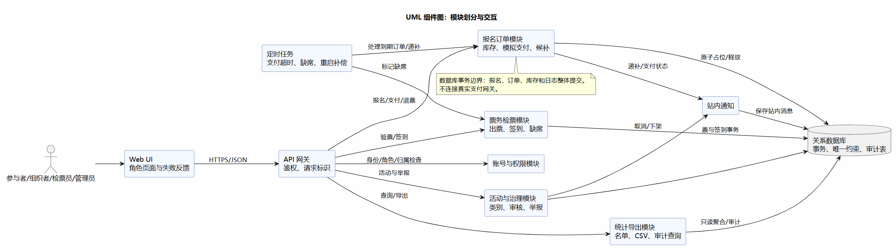

Web UI 经 API 网关进入五个业务模块。账号模块提供身份、角色和资源归属检查；活动模块维护类别、审核、举报与活动状态；报名模块维护候补顺序、订单和库存；票务模块出票、验票和签到；统计模块读取持久记录并输出 CSV；定时任务处理待支付到期和缺席。站内通知保存支付、取消和递补结果。

失败恢复：对应 REQ-012、029、034——定时任务、启动时和相关请求检查到期订单；页面遇到网络错误显示失败与重载入口，结果不明时从服务器重新读取订单、票和报名状态

### 2. 核心实现类

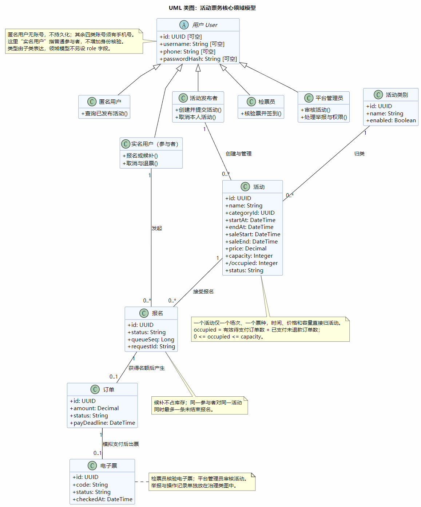

用户实际分为五类：访客、参与者、活动发布者、检票员、平台管理员，id、username、phone、passwd全局唯一；
活动类别、活动也是一个类，报名也是一个类因为涉及到排队和候补的问题，报名后形成订单、订单成交后形成电子票，都记录时间。id、场次信息。

### 3. 业务流程与状态转换
对应 REQ-005～008、010～018、020、031、032：
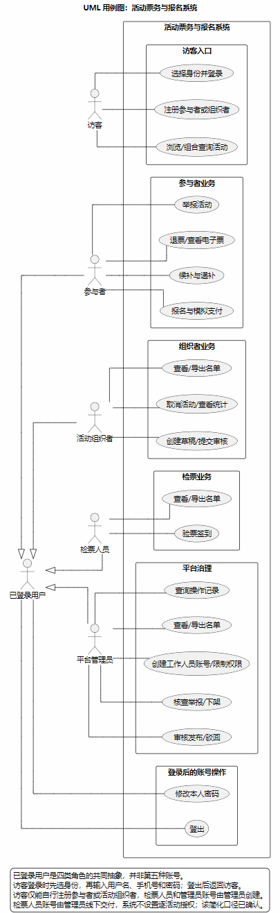
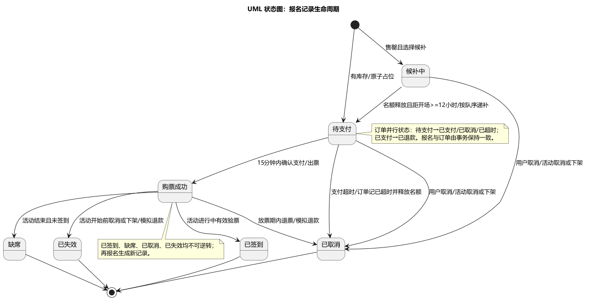
主流程：组织者保存草稿 → 提交审核 → 管理员通过并发布 → 参与者组合查询 → 有库存则创建待支付订单并占位，售罄则确认入候补 → 15 分钟内点击确认支付并出票 → 活动进行中检票签到 → 活动结束后把未签到购票记录标记缺席 → 查询统计与导出。参与者可在放票期内取消或退票；组织者取消、管理员基于举报下架时处理未完成订单、候补和模拟退款。

活动状态：草稿 → 审核中 → 已发布；审核中可撤回或被驳回回草稿。已发布活动在开始前可由组织者取消；管理员仅在有效举报属实且活动未开始时下架。已取消与已下架均为终态。活动开始后属实举报可记录违规，但不能再改变活动状态或既有签到结果。

订单状态：待支付 → 已支付 / 已取消 / 已超时；已支付 → 已退款。其余逆向转换均禁止。报名状态包含候补中、待支付、购票成功、已取消、已签到、缺席、已失效；票状态包含有效、已验票、已失效。订单超时对应的报名转已取消，订单转已超时；已验票票不能恢复有效。终态保留历史，新一次报名生成新记录。

### 4. 最后一张票的情况
对应 REQ-028、029：
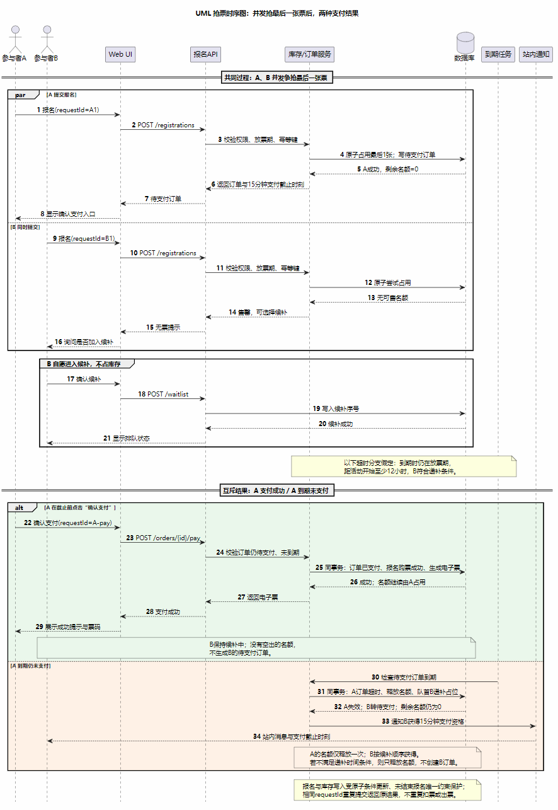
同一活动的占位检查与订单写入放在一个数据库写事务中。服务端成功写入的递增序号决定先后；即使两个请求的时间戳相同，也只有一人占最后一个名额。售罄者由页面确认是否进入候补。放票期内释放名额时，在距离活动开始至少 12 小时的条件下按候补序号递补；得到资格的订单有 15 分钟支付时限。可用名额优先给现有候补，不能让新请求插队。
报名、支付、退款、签到、递补分别用请求标识和当前状态约束只生效一次；数据库唯一索引负责兜底。事务失败全部回滚，成功后再给出结果或站内提示。旧页面操作必须复核当前活动和订单状态。

## 四、UI 设计与功能说明
UI 界面主要使用的是黑色导航、青绿色主操作、橙色待办与红色风险提示
### 账号登录注册
REQ-001、002、027、033：
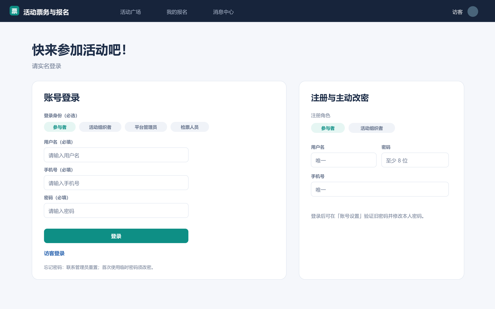
对应登录、两类自助注册、密码规则与首次改密提示。检票员和管理员不开放自助注册但是可以登录；登录后在账号设置主动改密

### 活动组合查询
REQ-009、030：
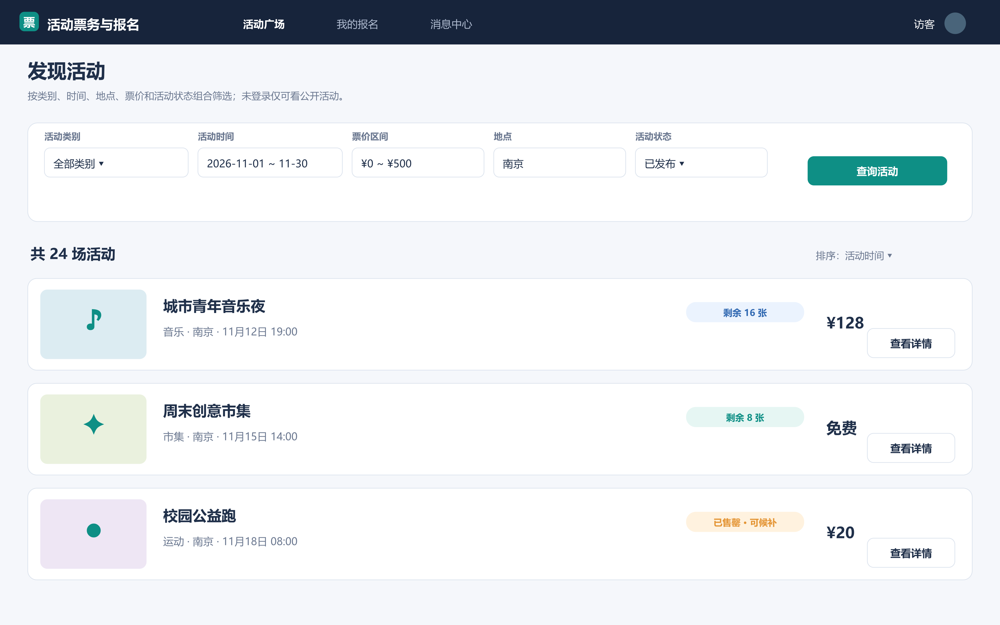
组合筛选类别、时间、票价、地点，展示剩余名额与售罄候补入口；分页和排序由后端执行

### 活动详情与候补
REQ-010、013、014、019、034：
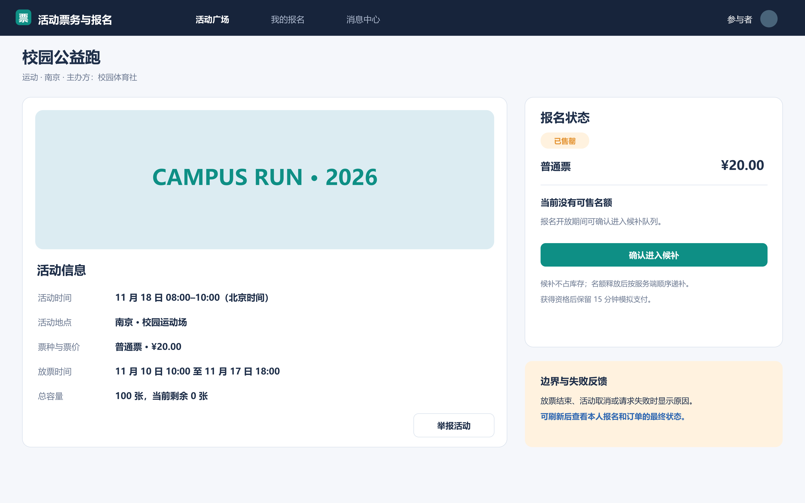

展示唯一场次、票价、放票区间、容量和当前名额；售罄时明确由参与者确认入候补，显示举报入口、截止规则和失败刷新入口
### 订单与电子票
REQ-011、012、015、016、031、034：
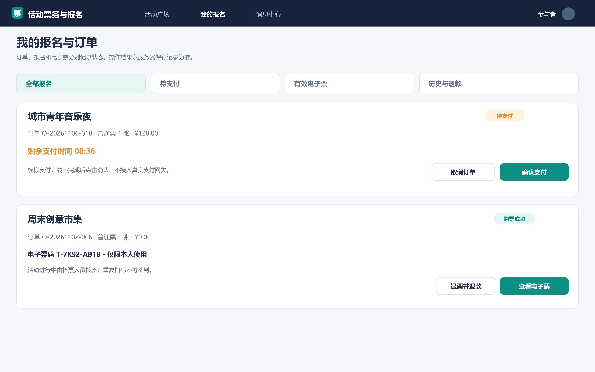

待支付倒计时、模拟支付、取消、退票并确认退款、电子票码和最终状态查看。不同状态的操作按钮应按服务端许可显示
### 组织者活动编辑
REQ-003～007：
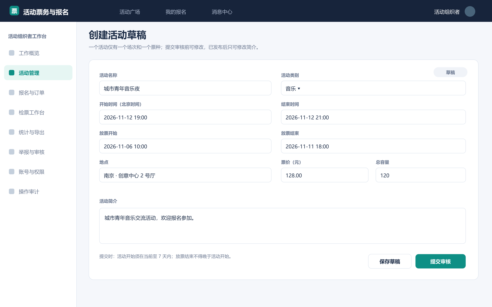

一个场次和票种的字段录入、草稿保存和提交审核；表单提示时间、容量及文本边界
### 组织者统计导出
REQ-022～024、026：
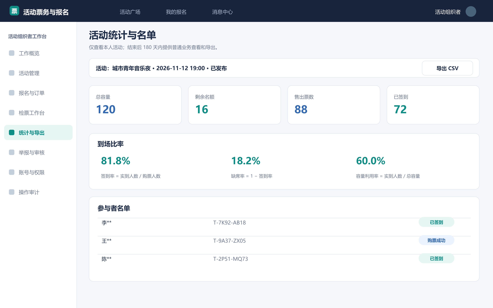

容量、剩余名额、售出票数、实到人数与三项比率，组织者仅访问本人活动。分母为零时比率显示 -1，不做除法。统计口径和检票员名单权限已确认
### 检票工作台
REQ-016～018、029：
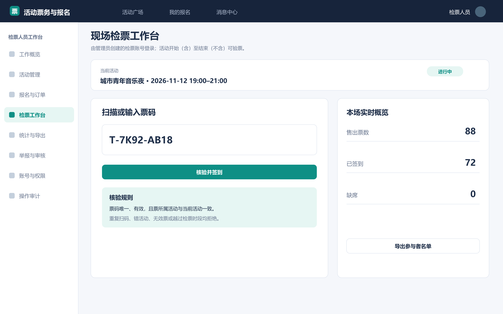
选定活动后扫码或输入票码，只在活动进行时核验有效票并签到；错活动、重复扫码或无效票显示明确失败
### 管理员审核举报
REQ-006、019、020、027：
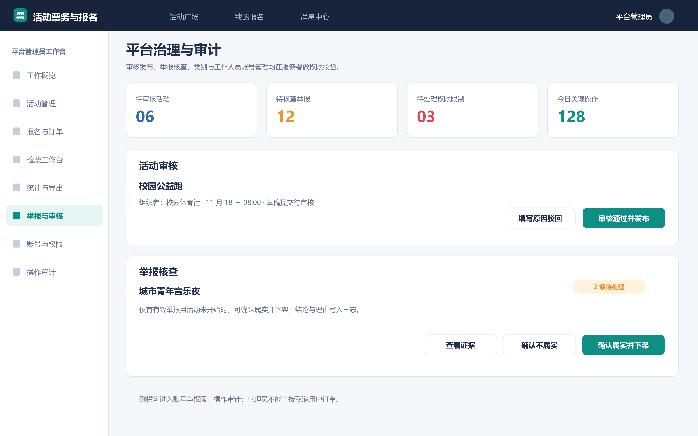
审核通过/带原因驳回、举报证据与结论、基于举报的下架，以及账号权限和审计入口。管理员不能直接取消用户订单
### 组织者活动状态管理
REQ-005～008、025：
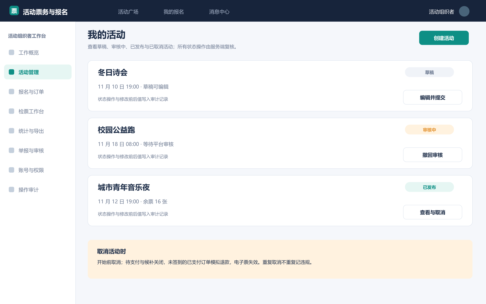

**UI-09 活动状态管理**：按草稿、审核中和已发布查看本人活动；提供编辑提交、撤回和开始前取消入口，提示取消后订单、候补和票的联动结果
### 管理员账号权限类别
REQ-002、003、021、027：
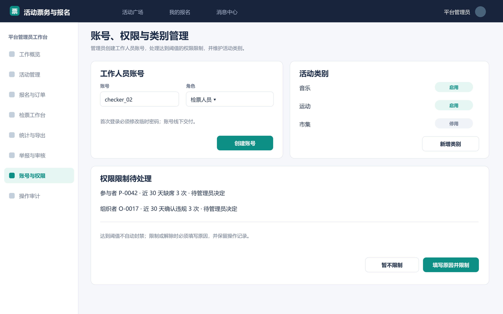
创建工作人员账号、维护类别、处理达到阈值的权限限制；限制前填写原因，达到阈值不自动封禁
### 管理员操作审计
REQ-025、026：
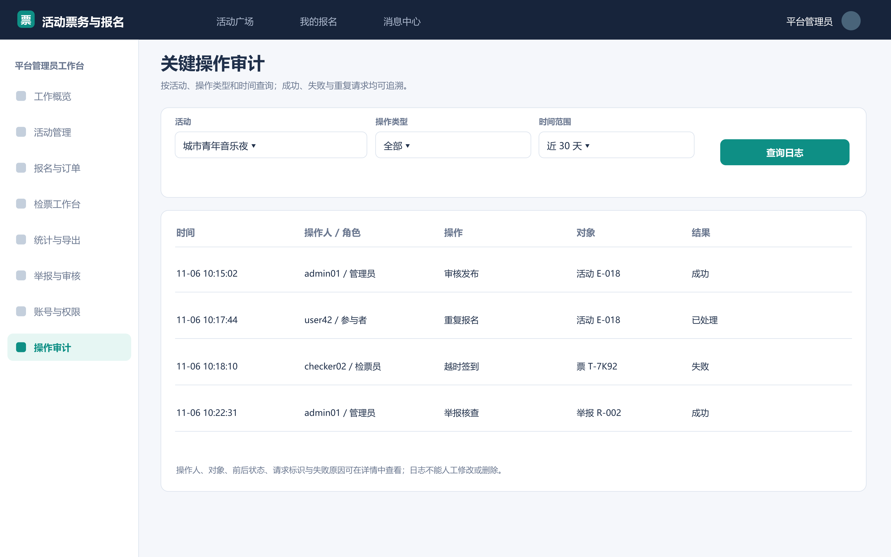
按活动、类型和时间查询成功、失败及重复请求记录，可查看操作人、前后状态和请求标识
### 主动改密表单
REQ-033：
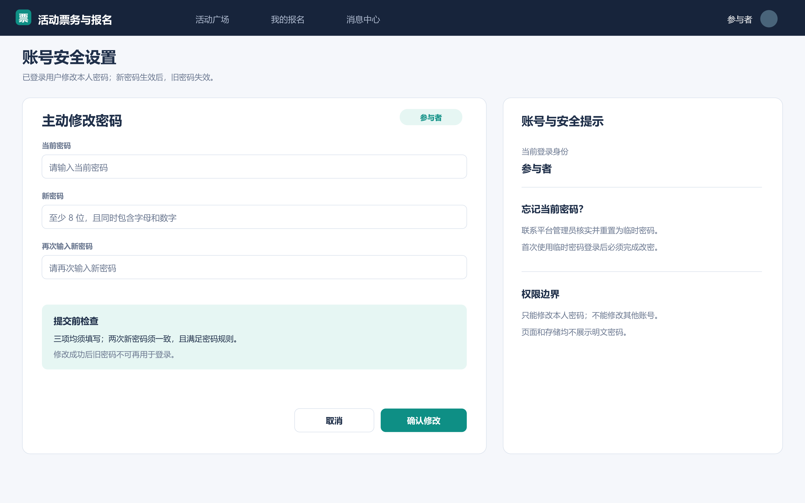
已登录的用户可以主动改密码，界面会一直显示自己是参与者还是管理员还是检票员还是访客，需要输入当前密码和新密码和验证新密码，忘记密码需要联系管理员，管理员核实后将密码重置并通过短信发给用户（这里就当做线下实现，因为不接入真实短信）
### 举报原因填写
REQ-019：
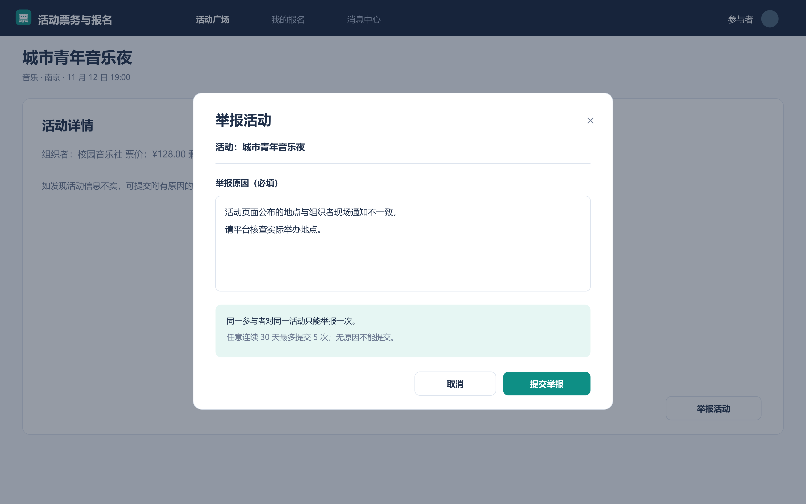
对活动点击举报后会显示举报活动标题，必填举报原因
### 退票确认
REQ-015：
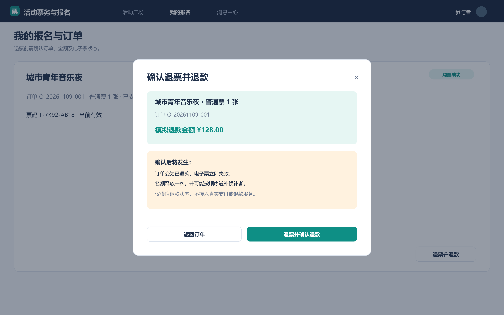
退票时因为是模拟的支付系统，所以点击退票并确认退款就认为款项到账了，会显示退票的活动标题和金额和订单号和退票提示
### 网络失败与重载
REQ-034：
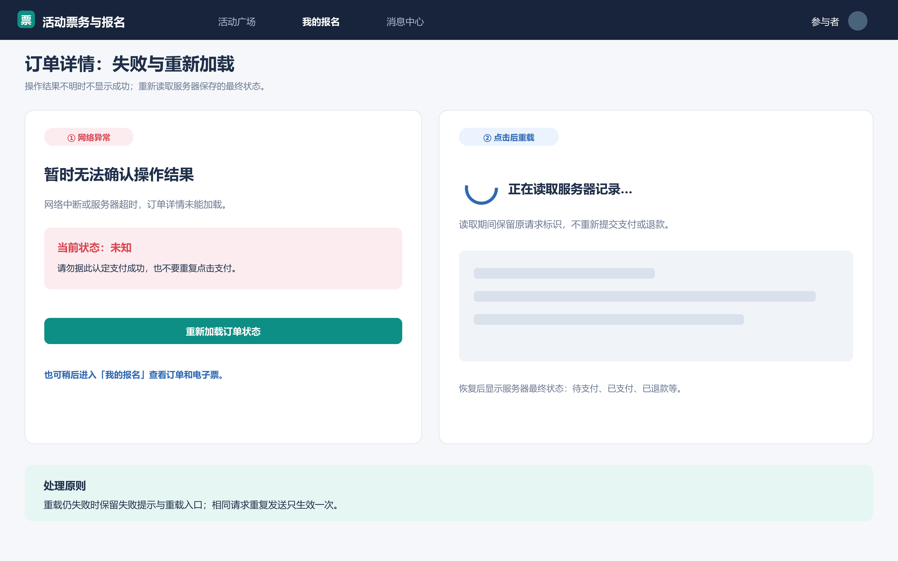
这个 UI 是为了加载失败、网络不好的时候准备的，异常的话会是左边红色部分，点击后重载界面是右边的部分
## 五、项目本身无关的验证
### 安全（REQ-027）
以四种角色和匿名身份直接请求所有受限接口，含伪造页面请求和跨活动资源；未授权成功次数必须为 0，存储和响应不能出现明文密码。
### 一致性（REQ-028、029）
20 抢 1 只能有 1 个待支付订单，10 抢 5 只能有 5 个；余额始终非负。支付、退款、递补、签到的中途故障不得出现部分更新。
### 性能（REQ-030）
预置 1000 个活动、20 个并发查询用户，执行 100 次列表查询，至少 95 次在 2 秒内成功；失败和超时计为未达标。
### 可恢复性（REQ-012、034）
重启后到期检查可处理待支付订单，页面请求失败后可重载并查明最终状态，重试不重复生效。

## 六、AI 辅助过程
### 使用 AI 理解此次实验的要求
我：传给 AI 我的 requirements
1. 什么是软件架构UML图？结构性图、行为性图、交互性图的优势各是什么？
2. 根据我的项目的REQ，可以把要求分为哪几个板块来绘制UML图？
3. 请以我的项目的抢票时序图为例，教会我如何绘制UML图
4. 请给我可参考的UI设计方向，需要为哪些页面设计UI？
AI：给出 UML 抢票时序图的示例
1. 什么是软件架构 UML 图？
“软件架构 UML 图”不是某一种固定图名，而是用 UML 图说明系统由什么组成、各部分负责什么、如何协作。你们项目的整体架构是：Web 页面经 API 调用账号、活动、报名订单、检票、统计模块，这些模块共享数据库，并由定时任务处理超时和缺席。

| 类别 | 回答的问题 | 对本项目的优势 |
| --- | --- | --- |
| 结构性图：类图、组件图 | 系统有哪些对象或模块？它们如何关联？ | 能检查票、订单、报名、活动之间的数据关系，以及模块职责是否清楚。 |
| 行为性图：用例图、状态图 | 谁能做什么？对象能从什么状态变成什么状态？ | 能发现角色越权、遗漏的终态和不允许的状态转换。 |
| 交互性图：时序图 | 一次操作中，参与者、服务和数据库按什么顺序交互？ | 特别适合说明抢最后一张票、支付超时、候补递补和重复请求。 |

因此，图要配合阅读：组件图看全局，类图看数据，状态图看规则，时序图看某条流程怎样执行。

2. 根据 REQ，怎样划分绘图板块？

| 板块 | 主要需求 | 适合重点画什么 |
| --- | --- | --- |
| 账号与权限 | REQ-001～002、021、027、033 | 用例图中的四类角色；组件图中的鉴权模块 |
| 活动管理与治理 | REQ-003～008、019～020 | 活动状态转换；组织者提交与管理员审核 |
| 报名、订单与候补 | REQ-009～015、028～032 | 报名状态图、订单状态、抢票与递补时序图 |
| 电子票与检票 | REQ-016～018、022 | 类图中的票与用户、订单、活动关系；验票流程 |
| 统计、导出与审计 | REQ-023～026、030 | 组件图中的统计模块及数据库；角色可查看的数据范围 |
| 跨模块质量要求 | REQ-027～030、034 | 在图中标出权限检查、事务、唯一约束、失败重试和提示 |

3. 以抢票时序图为例，怎样画？

先只确定**一个场景**：活动剩最后一张票，A、B 同时提交；一人占到名额，另一人选择候补；占票者 15 分钟未支付，系统按条件递补。对应 REQ-010、012～014、028～029。

然后按以下顺序画：

**列参与方**：参与者 A、B，Web UI，报名 API，库存/订单服务，数据库，到期任务，站内通知。它们从左到右排在图顶端，竖虚线表示各自随时间延伸。
**画请求箭头**：如“参与者 → UI：点击报名”“UI → API：提交报名”“服务 → 数据库：检查并占位”。实线表示请求，虚线通常表示返回结果。
**画并发分支**：PlantUML 的 `par ... else ... end` 表示 A、B 的请求可以同时进行。图中 A 获胜只是**一个示例结果**；实际获胜者由服务端成功写入顺序决定，不由用户 ID 或两个时间戳决定。
**画判断与后续事件**：数据库事务保证只有一个请求占到最后名额；B 收到售罄结果后自行确认候补。用 `... A未支付满15分钟 ...` 表示时间经过，再画到期任务释放名额、将队首候补转成待支付、发送站内消息。
**核对规则**：图上每一次库存变化都应对应订单或报名状态变化；重复请求只能返回已有结果。

这张现有图有一个简化：**递补箭头没有展开“仍在放票期且距活动开始至少 12 小时”的判断分支**。
4. UI 应设计哪些页面？

UI 图要让读者看出**显示的数据、输入项、操作按钮、状态提示和失败反馈**。建议按角色覆盖：

| 使用者 | 页面 |
| --- | --- |
| 公共与参与者 | 登录注册、活动组合查询、活动详情与举报/候补、我的订单与电子票 |
| 活动组织者 | 活动草稿编辑、我的活动状态与操作、统计和 CSV 导出 |
| 检票人员 | 选活动、输入或扫描票码、验票与签到结果 |
| 平台管理员 | 活动审核与举报核查、账号权限与类别管理、操作审计查询 |
### 使用 AI 根据我的要求生成初版 UML 图
我：根据我的 requirements 生成 UML组件图、类图、用例图、报名状态图。其中，UML组件图展示 requirements 要求的项目的板块间的结构，即将整个项目的实现分为账号模块、活动模块、报名模块、票务模块出票、统计模块和定时任务处理模块；UML类图根据 REQ-001～034 生成；UML用例图表明四个角色的权限边界；UML报名状态图根据requirements和draft里的主流程来生成。
AI：给出了四张初版 UML 图
### 人工审查与修改

1. UML图没有这么多类，user的子类也不应该是参与者、举报者、操作人、组织者，而是匿名用户、实名用户、平台管理员、检票员、活动发布者，而且 User 只有 phone 没有 email，role 字段多余，所以对 UML类图进行了修改；

2. AI 给出的 UML用例图有个地方弄错了，参与者、活动组织者、平台管理员、检票人员只能登录/改密/登出，登录就是选择身份，填入相应用户名、电话号码、passwd之后登录，登出就是变成访客，只有访客可以注册/登录，访客只能浏览/组合查询活动和注册/登录成为其他人，所以对 UML用例图进行了修改；
   
3. UML抢票时序图的排版稍微有点问题，内容倒是和我的 requirements 一样，所以稍微改了一下排版，分类讨论了一下时序图。

### 反思
AI 可以非常快速地让我理解实验意思和让我上手陌生的工具和概念，也可以很好地处理有很具体很细化的操作，但是人为的审核和调整必不可少，因为感觉 AI还是会自由发挥，没说的他就理解不了，比如说访客和其他用户的关系其实是登出和登录的关系，这种隐含的概念他就没法理解，必须人工核验。